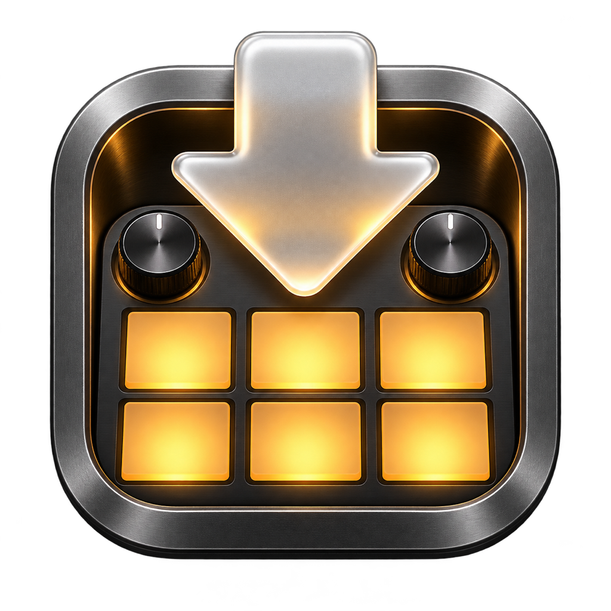

  

# BentoDrop

BentoDrop is a macOS app for preparing samples and managing the SD card used by the **1010 Music Bento**. It converts audio to verified 48 kHz, 24-bit WAV, keeps a log of each sync, and helps you back up the card and prepare firmware updates.

[Latest stable release](https://github.com/andypduk/BentoDrop-Updates/releases/latest) · [All releases](https://github.com/andypduk/BentoDrop-Updates/releases) · [Full help guide](docs/Help.md)

## Install and connect

1. On a Mac running macOS 15 or later, download `BentoDrop.dmg` from GitHub Releases. Open it and drag BentoDrop into **Applications**.
2. Save your project on the 1010 Music Bento. Connect the device with a USB-C data cable and select **PROJ → Menu → SD Reader Mode**, or use a microSD card reader.
3. Wait for the card to appear in Finder. Open BentoDrop, select the card in the right-hand **Card** pane, and choose **Grant Access**. Select the root of that card.
4. To set a preferred backup location, choose **Card → Set Up BentoDrop…**. BentoDrop remembers the card and backup folder permissions you grant through macOS.

## Send samples to the 1010 Music Bento

1. Click **New Sample Sync…** in the toolbar or Queue, or press **Command-Return**.
2. Name the job, choose a destination under `UserSamples`, then choose **Add Files or Folders…**. You can also drag audio files from Finder into the Queue.
3. Review the destination paths and any excluded files. Choose **Skip existing** to keep matching files on the card, or **Overwrite existing** to replace matching destinations for this run.
4. Click **Run Sample Sync**. The white music note moves toward the studio as the job progresses. The dialog shows the current filename and the overall file count.
5. Review the result in **Sample Sync History**, then eject the card from the Card pane before disconnecting or leaving SD Reader Mode.

The Queue supports previewing, inspecting and removing source files. **Clear Queue** removes entries without deleting files. Transferred and skipped entries clear after the run; failed and unattempted entries remain available for retry during that session.

## Audio formats you can convert

BentoDrop writes **48 kHz, 24-bit integer PCM WAV**, mono or stereo, under `UserSamples`. It checks the converted format before copying and verifies the written bytes. Source files must be nonempty, decodable by macOS, and no longer than **30 seconds**.

| Input format | Recognised extensions |
| --- | --- |
| WAV | `.wav`, `.wave` |
| AIFF | `.aiff`, `.aif`, `.aifc` |
| Core Audio Format | `.caf` |
| FLAC | `.flac` |
| MPEG audio | `.mp3`, `.mp2` |
| AAC and MPEG-4 audio | `.aac`, `.m4a`, `.m4b`, `.mp4` |
| 3GPP audio | `.3gp` |
| NeXT / Sun audio | `.au`, `.snd` |
| Sound Designer II | `.sd2` |
| Ogg Vorbis and Opus | `.ogg`, `.oga`, `.opus` |

The conversion tests cover WAV, AIFF, CAF, FLAC and AAC. The other extensions are recognised for inspection; whether a particular file converts depends on its encoding and the macOS decoder. The wizard lists files it excludes and why. Export proprietary sampler formats such as Kontakt NCW or REX to WAV in their original tools first.

## Review or rerun a sync

- Click a job in the left-hand **Sample Sync History** pane to see its outcome and log, including transferred, skipped, excluded and failed files. **Save Log…** exports a text file.
- Choose **Reprocess Job…** to review a new run using the original source files, destinations and conflict setting. Clear the current queue first. BentoDrop may ask you to grant access to the originals again. The rerun gets a separate history entry.
- Right-click a job and choose **Delete Job** to remove it from history. This does not delete any source files or samples on the card.

## Browse, back up and restore the card

In the **Card** pane, expand folders under `UserSamples`. Right-click a sample to **Play Preview** or **Stop Preview**. Drag a file or folder onto another folder to move it, or right-click to **Move to Folder**, **Rename**, or **Delete**. Moves and renames refuse to overwrite an existing item. Confirming deletion permanently removes the selected item and its folder contents.

Use **Card → Back Up Card…** or **Restore Card…** to back up or restore the card. Restore can replace matching files, so check the backup and selected card before proceeding. **Create Default SD Card…** prepares a card for the 1010 Music Bento with factory content and can hand off formatting to SD Card Formatter. Formatting erases the selected card; back it up first.

## Update firmware on the 1010 Music Bento

1. Choose **Card → Check for Firmware Updates…** or click the wand icon in the Queue. BentoDrop checks the official downloads page and compares the release with the firmware files on the card. If the site is temporarily unavailable (HTTP 503), BentoDrop retries three times with a two-second pause before each retry.
2. In the wizard, choose **Full card** or **Firmware files only**. Firmware-only backup saves the existing `bento1.bin` and `bento2.bin`; it does not back up samples, patches or projects. Choose a backup folder on a different drive from the SD card.
3. Download the official package and choose **Write Firmware**. BentoDrop verifies the new files at the card root. If a completed write leaves an update record, **Verify and Finish** checks the files and clears the record without rewriting them.
4. Eject the card and finish installation on the 1010 Music Bento using its bootloader. Follow the wizard’s device instructions and check the installed version with **PROJ**. The version on the SD card alone does not tell you which firmware the device is running.

For more help, choose **Help → Bento Drop Help** in the app or read the [full help guide](docs/Help.md), including [troubleshooting](docs/Help.md#troubleshooting).
